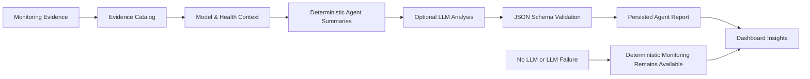
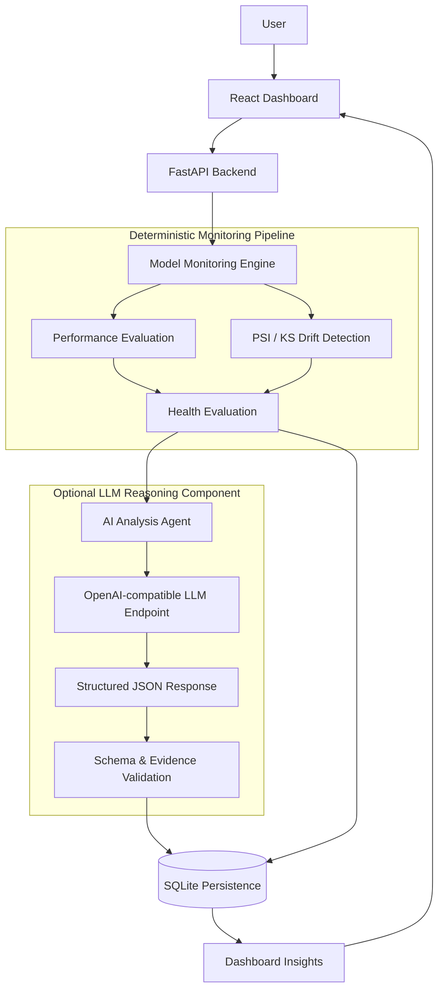

# ModelWatch – AI-Powered ML Monitoring & Intelligent Drift Analysis Agent

[](https://www.python.org/)
[](https://fastapi.tiangolo.com/)
[](https://react.dev/)
[](https://scikit-learn.org/)
[](https://www.docker.com/)
[](https://www.sqlite.org/)

**ModelWatch is an AI-powered ML model monitoring and analysis platform that combines deterministic statistical monitoring with an evidence-based AI analysis agent.**

It helps teams monitor deployed or uploaded machine learning models by evaluating real predictions, calculating supervised performance metrics, detecting feature distribution drift, determining model health, and presenting actionable monitoring insights. An integrated **AI Agent – Intelligent Model Health Analyst** interprets the monitoring evidence and can produce contextual, structured recommendations for human review.

ModelWatch is not limited to a dashboard of drift charts: it turns monitored model evidence into a decision-support workflow for identifying warning and critical conditions, investigating likely causes, prioritizing next actions, and evaluating alternative algorithms when labeled performance evidence justifies it.

---

## Why ModelWatch

- Registers and manages multiple model workspaces.
- Runs real estimator predictions against production datasets.
- Measures classification or regression performance.
- Detects numeric and categorical feature drift with PSI and the KS test.
- Uses deterministic rules to establish model health.
- Uses an optional OpenAI-compatible LLM to generate evidence-grounded, schema-validated analysis.
- Keeps historical monitoring runs, agent analyses, and alerts in SQLite.
- Preserves human control: the agent does not retrain, replace, or promote models.

---

## AI Agent – Intelligent Model Health Analyst

ModelWatch includes an evidence-based AI analysis agent that operates as a monitoring interpretation layer. It is not an autonomous operator or multi-agent system: it receives prepared evidence, generates structured analysis, and leaves decisions to the user.

### Agent workflow

1. **Monitoring Input**
   - Receives model metadata, algorithm name, problem type, and selected feature names.
   - Receives supervised performance metrics, deterministic health status and explanation, and PSI/KS drift statistics.

2. **Evidence Analysis**
   - Reviews the deterministic monitoring results.
   - Distinguishes performance degradation from feature drift.
   - Uses evidence IDs to ground findings and recommendations.

3. **Contextual Reasoning**
   - Interprets warning and critical signals.
   - Identifies possible implications and non-causal hypotheses.
   - Avoids speculative causes when evidence is insufficient.

4. **Structured LLM Analysis**
   - Sends aggregate evidence—not raw dataset rows or model files—to an OpenAI-compatible chat completions endpoint.
   - Requests a strict JSON schema with findings, causes, recommendations, alternative-model candidates, and limitations.

5. **Recommendation Generation**
   - Produces prioritized next steps based on the monitoring state.
   - May suggest up to three task-compatible alternative algorithms **only** when supervised labeled evidence supports evaluation.
   - Never treats drift alone as evidence for replacing a model.

6. **Validated Output**
   - Validates the response against a Pydantic JSON schema.
   - Checks evidence citations and problem-type compatibility.
   - Persists the structured agent output with the monitoring run.

7. **Human Decision-Making**
   - Presents explanations and recommendations in the dashboard.
   - Leaves retraining, model replacement, and production promotion to the user.



### Agent capabilities

- Evidence-grounded model health explanations.
- Intelligent interpretation of PSI and KS drift indicators.
- Context-aware recommendations for warnings and critical conditions.
- Identification of performance degradation and drifted features.
- Alternative algorithm suggestions only when labeled performance evidence is available.
- Structured JSON output with evidence IDs and Pydantic validation.
- Graceful fallback to deterministic monitoring when the LLM is unavailable or misconfigured.

---

## Agentic Workflow

The agent participates in the monitoring lifecycle after the deterministic pipeline has calculated the current model state:

1. The monitoring engine evaluates predictions, metrics, drift, and health.
2. The agent receives a prepared evidence package containing aggregate values and identifiers.
3. It interprets findings in context and distinguishes:
   - Feature drift.
   - Supervised performance degradation.
   - Insufficient evidence.
   - Healthy model conditions.
4. It generates prioritized, human-readable actions and documents limitations.
5. It communicates findings through the React dashboard and historical monitoring views.

This is an **evidence-based AI analysis agent**, not a claim of autonomous tool execution. ModelWatch does not collect additional tools, orchestrate multiple autonomous agents, initiate retraining, deploy alternatives, or automatically replace an active model.

---

## System Architecture



The left or top-level monitoring path is fully deterministic. PSI/KS drift, supervised metrics, and health rules remain authoritative and are not modified by the optional LLM. The LLM component enriches analysis after those results exist.

---

## Sample AI Agent Response

> **Illustrative example only — not actual recorded output.**

```json
{
  "model_health": "Warning",
  "findings": [
    {
      "feature": "Sleep Hours",
      "evidence": "Critical PSI drift",
      "interpretation": "The production distribution differs substantially from the reference distribution."
    },
    {
      "feature": "Hours Studied",
      "evidence": "Warning-level feature drift",
      "interpretation": "A notable distribution change warrants comparison with recent outcomes."
    }
  ],
  "recommendation": "Investigate production data distribution and validate model performance using labeled production data.",
  "alternative_algorithms": "Only suggest candidates if labeled performance evidence supports evaluation; otherwise do not recommend alternatives."
}
```

This example demonstrates the intended presentation format. It is not evidence that a specific dataset or monitored model produced these values.

---

## Monitoring Workflow

1. **Register a model**
   - Create a model workspace and provide its name, description, problem type, target, and feature columns.

2. **Upload a trusted pickle estimator**
   - Upload a trusted `.pkl` estimator and confirm its source.
   - Pickle/joblib files can execute code when loaded. Never upload files from unknown or untrusted sources.

3. **Upload reference and production CSV datasets**
   - Upload the original/reference dataset and current/production dataset.
   - The workspace displays previews, dimensions, and shared columns.

4. **Select features and target**
   - Choose independent features and a target.
   - ModelWatch can suggest feature selections when model feature names map to CSV columns.
   - Categorical columns are one-hot encoded when needed to match declared model feature names.

5. **Run monitoring**
   - The application runs actual estimator predictions.
   - It calculates supervised metrics, feature drift, health status, and agent analyses.
   - It persists the monitoring run and updates model and alert state.

6. **Review multiple model workspaces**
   - Select another uploaded model workspace to review its own datasets, health status, metrics, run history, and alerts.
   - New workspaces show **Not monitored** until a pipeline run completes.

### Metrics and health

- **Classification:** accuracy, precision, recall, F1, and ROC-AUC where supported.
- **Regression:** MAE, RMSE, and R².
- **Feature drift:** PSI and, for numeric features, the two-sample KS test.
- **Health:** `Healthy`, `Warning`, `Critical`, or `Insufficient Data`.
- **Insufficient Data:** no usable performance or drift signals were available.
- If production labels are missing, supervised metrics are unavailable and the health explanation states that monitoring is based on drift only.
- Warning/Critical statuses list detected signals and next actions on the Monitoring page.

### Historical monitoring

- Monitoring runs retain metrics, drift details, health status, explanations, and agent analyses.
- Alerts are created for non-healthy runs.
- Users can acknowledge alerts through the API.

---

## Technology Stack

| Area | Technology |
|---|---|
| Frontend | React, Vite |
| Backend | Python, FastAPI |
| Machine Learning | Scikit-learn |
| Data processing | Pandas, NumPy |
| Statistical drift | PSI, Kolmogorov-Smirnov Test |
| AI reasoning | OpenAI-compatible LLM API, structured JSON output |
| Database | SQLite |
| Deployment | Docker Compose |

---

## Requirements

- Python 3.10+
- Node.js 20+
- Docker with Docker Compose, for containerized deployment

---

## Installation

### Backend

```powershell
cd backend
python -m venv .venv
.venv\Scripts\Activate.ps1
pip install -r requirements.txt
uvicorn app.main:app --reload --host 0.0.0.0 --port 8000
```

API documentation: `http://localhost:8000/docs`

Keep the backend process running while using the frontend. Vite forwards `/api` requests to the backend.

### Frontend

```powershell
cd frontend
npm install
npm run dev
```

Dashboard: `http://localhost:5173`

---

## Optional Structured LLM Analysis

ModelWatch can request a JSON-schema-constrained explanation from an OpenAI-compatible chat completions endpoint.

Create `backend/.env`:

```dotenv
LLM_API_KEY=your-provider-api-key
LLM_MODEL=openai/gpt-oss-20b
LLM_BASE_URL=https://api.groq.com/openai/v1
```

The backend loads this file automatically. Restart the backend after editing it.

- `LLM_API_KEY`: API key for the OpenAI-compatible provider.
- `LLM_MODEL`: model identifier to request.
- `LLM_BASE_URL`: provider base URL.
- For Docker Compose, the backend service loads `backend/.env` automatically.

Example `backend/.env.example` values are safe templates only:

```dotenv
LLM_API_KEY=
LLM_MODEL=
LLM_BASE_URL=https://api.openai.com/v1
```

The key is never sent to the browser or stored in SQLite. If the LLM is unconfigured or unavailable, the UI reports that state and deterministic monitoring remains available.

---

## Security and Reliability

- API keys remain on the backend.
- Raw dataset rows and trained model files are not sent to the LLM.
- LLM requests contain model metadata, selected feature names, aggregate metrics, health status, and drift statistics.
- The LLM cannot change deterministic health, alert, or drift decisions.
- Structured responses are validated against a constrained Pydantic/JSON schema.
- Evidence citations are checked against the supplied evidence catalog.
- Alternative models must belong to the supported classification or regression list and must cite available supervised metric evidence.
- Deterministic monitoring continues if LLM configuration is missing or the endpoint fails.
- Alternative algorithms are evaluation candidates only and are never trained or promoted automatically.
- Training-versus-validation diagnostics are not collected, so the agent does not infer overfitting or underfitting.

---

## API Endpoints

- `POST /api/models`
- `GET /api/models`
- `PUT /api/models/{id}`
- `DELETE /api/models/{id}`
- `POST /api/models/{id}/datasets?dataset_type=reference|production`
- `POST /api/models/{id}/monitor`
- `GET /api/models/{id}/runs`
- `GET /api/alerts`
- `POST /api/alerts/{id}/acknowledge`
- `GET /api/dashboard`
- `GET /api/llm/status`

Interactive API documentation: `http://localhost:8000/docs`

---

## Tests

```powershell
cd backend
.venv\Scripts\Activate.ps1
pytest -q
```

---

## Docker

```powershell
docker compose up --build
```

The Docker Compose setup starts the FastAPI backend and React frontend services.

---

## Limitations and Future Improvements

### Current limitations

- The LLM is an optional reasoning and explanation layer; it is not required for monitoring.
- No autonomous retraining or model deployment is performed.
- Alternative algorithms are candidates for evaluation, not benchmarked or trained recommendations.
- The platform does not infer overfitting or underfitting because training/validation diagnostics are not stored.
- The monitoring setup does not replace production model serving or MLOps infrastructure.

### Potential improvements

- Add authentication and role-based access.
- Add automated historical-baseline comparisons across runs.
- Add richer data quality and missing-value diagnostics.
- Add configurable monitoring thresholds through the dashboard.
- Add evaluation workflows for suggested alternative algorithms.
- Add exportable reports and external alert integrations.

---

## Repository Structure

```text
backend/
  app/
    agents/       AI agent orchestration and LLM structured analysis
    models/       Database models
    monitoring/   Metrics and drift calculations
    routers/      FastAPI routes
    services/     Health and model artifact services
  tests/          Backend test suite
frontend/
  src/            React dashboard
datasets/         Example reference and production CSV files
docs/             Architecture documentation
docker-compose.yml
```
